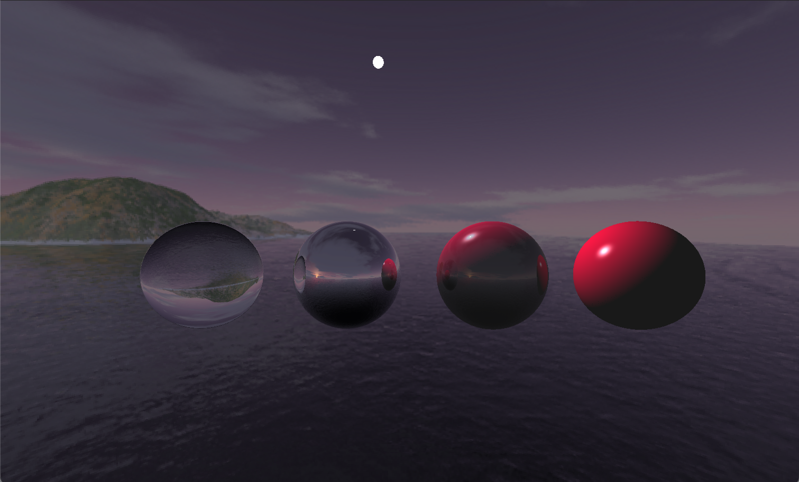
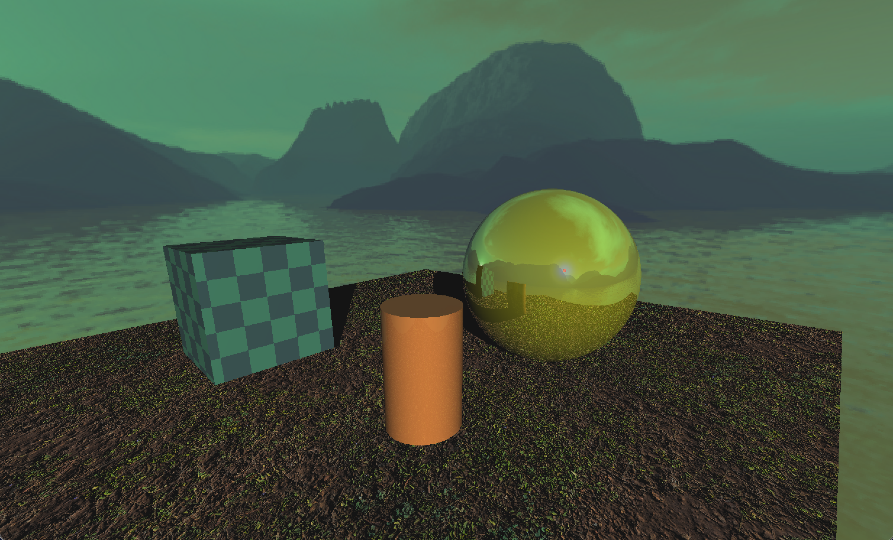
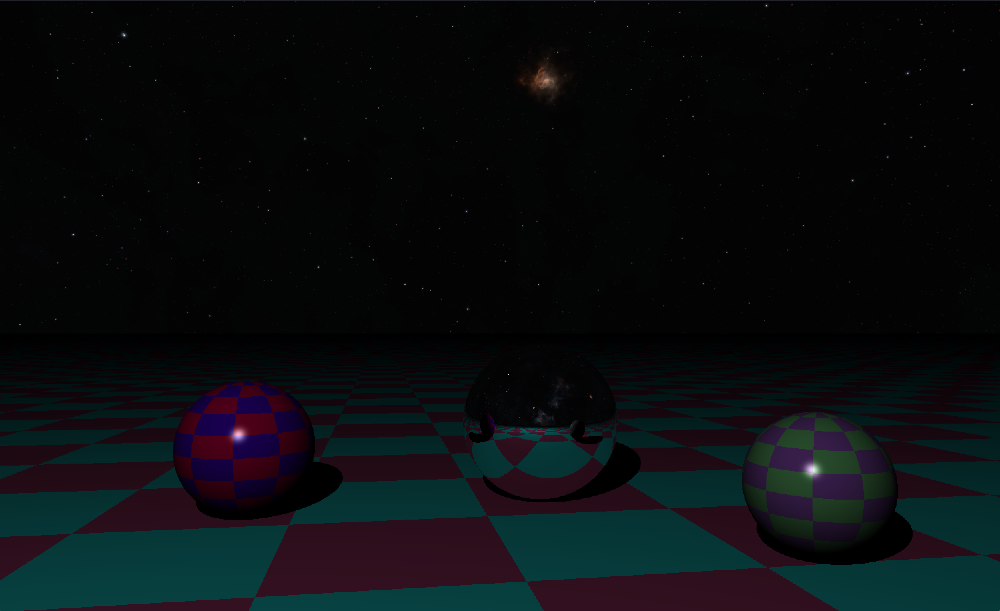

_This project has been created as part of the 42 curriculum by jpelline and zfarah._
# miniRT
A Multithreaded CPU Ray Tracer with Phong Lighting Model.

<p align="center">
	
</p>

<table align="center">
  <tr>
    <td></td>
    <td></td>
  </tr>
</table>

## Features
- Multithreaded Rendering: Parallelized CPU ray tracing to improve rendering performance and utilize multiple CPU cores.
- Perspective Camera: Configurable field of view (FOV) for flexible perspective projection.
- Camera Controls: Real-time camera movement and look around.
- Geometric Primitives: Support for spheres, planes, cubes, cylinders, and paraboloids.
- Phong Lighting Model: Point and spot light sources with ambient, diffuse, and specular lighting components.
- Hard Shadows: Sharp shadow generation for realistic light occlusion and scene depth.
- Reflective and Refractive Surfaces: Recursive ray tracing for reflections and refractions.
- UV Texture Mapping: Texture coordinate generation and mapping for spheres, planes, and cubes.
- Procedural Texturing: Checkerboard patterns generated procedurally without external texture assets.
- Paraboloid Skyboxes: Environment backgrounds using paraboloid-based skybox mapping.
- Normal Mapping: Surface normal perturbation for enhanced geometric detail without additional polygonal geometry.
- Scene Editing: Select, move, rotate, and scale objects directly within the scene.
- Automatic Scene Saving: Optional scene autosave functionality enabled through the `--autosave` command-line flag.

## Scene File Format
Using a custom .rt scene format to define cameras, light sources, geometric primitives, materials, textures, and skyboxes.
Each scene component is defined using a type identifier followed by its corresponding parameters.
```
# Sphere: position, radius, RGB color, optional reflectivity, refraction index, image texture ID
sp  16.00,0.00,-4.00  6.0  255,255,255  rl 1.0  rf 1.3 img 1
sp <position> <radius>  <color> [rl <reflectivity> rf <refraction_index> img <texture_id>]
```
A complete scene file demonstrating all supported formats and their usage can be found at: ``scenes/example.rt``.
Use it as a reference when creating your own scenes or exploring the renderer's capabilities.

## Controls & Editing

Interact with the scene using the following mouse and keyboard shortcuts to navigate the camera and manipulate objects in real time.

| Input                | Action                      |
| -------------------- | --------------------------- |
| `wasd` | Camera movement |
| `Right Click (Hold)` | Camera look around |
| `Z + Right Click (Hold)`    | Pick object     |
| `X + Right Click (Hold)`    | Rotate object      |
| `C + Right Click (Hold)`    | Scale object       |
| `ESC`                | Quit application            |
## Getting Started

### Prerequisites

- C compiler with C89 standard support.
- `make` build utility.

### Build

Clone and compile the project by running:
```bash
git clone <repository-url> miniRT
cd miniRT
make
```

### Run

Launch the renderer with a scene file:

```
./miniRT scenes/material.rt
```

To automatically save the rendered scene, enable the optional `--autosave` flag:

```
./miniRT scenes/material.rt --autosave
```

## Resources & References

- [Ray Tracing in One Weekend](https://raytracing.github.io/books/RayTracingInOneWeekend.html?utm_source=chatgpt.com)
- [Ray Tracing Mathematics – YouTube](https://www.youtube.com/watch?v=6MD_CTQGDyo\&list=PLTd6ceoshprfZs1VIzGHDt-MYgVewC5tc\&index=3\&utm_source=chatgpt.com)
- [Phong Illumination Model Cheat Sheet](https://rodolphe-vaillant.fr/entry/85/phong-illumination-model-cheat-sheet?utm_source=chatgpt.com)
- [Phong Lighting – YouTube](https://www.youtube.com/watch?v=LKXAIuCaKAQ\&t=72s\&utm_source=chatgpt.com)
- [Ray Tracing Adventure – Part IV](https://medium.com/@dbildibay/ray-tracing-adventure-part-iv-678768947371?utm_source=chatgpt.com)
- [Creating Better Hard Shadows for Refractive Materials](https://medium.com/@ghostec/creating-better-hard-shadows-for-refractive-materials-ray-tracing-fbb5ef0ff307?utm_source=chatgpt.com)
